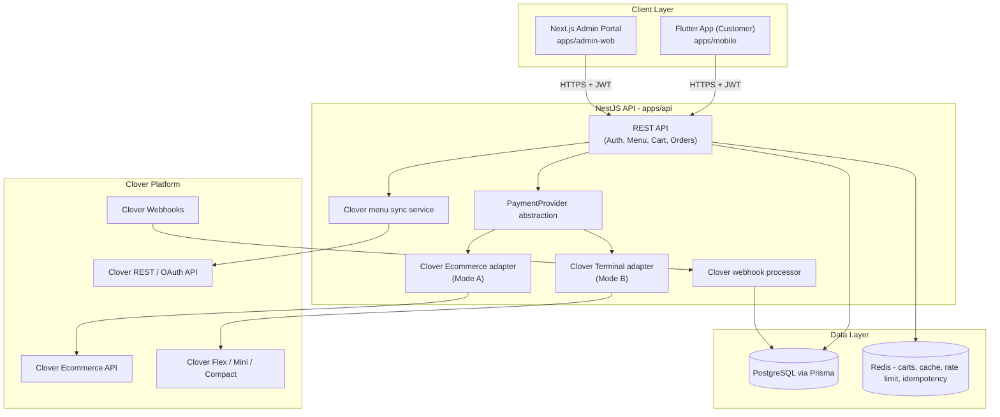

# Restaurant Platform

Production-oriented restaurant ordering platform: a Flutter customer app, a NestJS/
PostgreSQL/Redis backend, and a Next.js restaurant admin portal, integrated with Clover
for menu sync, order creation, payments, refunds, and order-status management.

This repository is being built **incrementally, phase by phase** (see [Build phases](#build-phases)
below). This README reflects through **Phase 2**: monorepo scaffolding, architecture,
configuration, database schema, Docker setup, health endpoints, shared types, developer
docs (Phase 1), plus authentication, restaurant/menu read endpoints, and Clover OAuth +
inventory sync (Phase 2). Cart pricing, checkout/payments, webhooks, and the admin/mobile
UIs are added in later phases.

## Product overview

Customers browse a restaurant's menu (no login required), order pickup or delivery,
pay through Clover, tip, and track their order live. Restaurant admins connect their
Clover account, import/manage the menu, configure business rules (hours, fees, taxes,
delivery radius), run the live order queue, and issue refunds. Employees handle the
order queue without touching payment/ownership settings.

## Architecture



The mobile app never calls Clover directly and never handles secrets - see
`SECURITY.md` for the full trust boundary.

## Technology stack

**Mobile**: Flutter, Dart, Material 3, Riverpod, GoRouter, Dio, Freezed +
json_serializable, flutter_secure_storage, Firebase (Messaging/Crashlytics/Analytics).

**Backend**: Node.js, TypeScript, NestJS, PostgreSQL, Prisma, Redis, Swagger/OpenAPI,
Docker, Jest.

**Admin portal**: Next.js (React, TypeScript).

**Payments**: Clover Ecommerce API (online/card-not-present) and Clover REST Pay
Display API (in-restaurant terminal), behind a shared `PaymentProvider` interface -
see `CLOVER_SETUP_GUIDE.md`.

## Monorepo layout

```
restaurant-platform/            (this repo root)
  apps/
    mobile/         Flutter customer app
    admin-web/      Next.js restaurant admin & employee portal
    api/            NestJS backend API
  packages/
    shared-types/   Shared TS enums & API contracts
    api-client/     Typed HTTP client used by admin-web
    eslint-config/  Shared ESLint config
  infrastructure/   (reserved for IaC / deployment manifests, added in later phases)
  docs/             (reserved for expanded architecture/runbooks, added in later phases)
  .github/workflows/  CI pipelines
  docker-compose.yml
  README.md, SECURITY.md, GOOGLE_PLAY_RELEASE_GUIDE.md, CLOVER_SETUP_GUIDE.md
```

## Local setup

### Prerequisites

- Node.js 20+
- npm 10+
- Docker Desktop (for Postgres/Redis, and optionally the API container)
- Flutter SDK 3.24+ (only needed to run the mobile app - see `apps/mobile/README.md`)

### 1. Install dependencies

```bash
npm install
```

### 2. Configure environment variables

```bash
cp .env.example .env
cp apps/api/.env.example apps/api/.env
cp apps/admin-web/.env.example apps/admin-web/.env
```

Fill in real values only where you have them (Clover/Firebase). Everything else has a
safe local-dev default. See [Environment variables](#environment-variables) below.

### 3. Start Postgres & Redis

```bash
docker compose up -d postgres redis
```

### 4. Run database migrations & seed data

```bash
npm run prisma:generate
npm run prisma:migrate
npm run prisma:seed
```

### 5. Run the backend

```bash
npm run api:dev
```

The API listens on `http://localhost:3000/api/v1`, with Swagger docs at
`http://localhost:3000/api/v1/docs` and a health check at
`http://localhost:3000/api/v1/health`.

### 6. Run the admin portal

```bash
npm run admin:dev
```

Open `http://localhost:3001`.

### 7. Run the mobile app

See `apps/mobile/README.md` for full instructions (generating the Android/iOS platform
folders, Firebase config, and run commands).

## Environment variables

Defined in `apps/api/.env.example` (copy to `.env`, never commit the real file):

| Variable | Purpose |
|---|---|
| `CLOVER_ENVIRONMENT` | `sandbox` or `production` - selects Clover API base URLs |
| `CLOVER_CLIENT_ID` / `CLOVER_CLIENT_SECRET` | Clover OAuth app credentials |
| `CLOVER_MERCHANT_ID` | Connected merchant (set after OAuth) |
| `CLOVER_REDIRECT_URI` | OAuth callback URL |
| `CLOVER_WEBHOOK_SECRET` | Verifies inbound Clover webhook signatures (Phase 5) |
| `CLOVER_ECOMMERCE_PUBLIC_KEY` / `CLOVER_ECOMMERCE_PRIVATE_KEY` | Ecommerce tokenization/charge keys (Phase 4) |
| `CLOVER_API_BASE_URL` / `CLOVER_OAUTH_WEB_BASE_URL` | Optional overrides of the resolved Clover hosts (e.g. non-North-America regions) |
| `CLOVER_USE_MOCK_CLIENT` | Force the in-memory mock Clover adapter; defaults to `true` when no Clover credentials are set |
| `TOKEN_ENCRYPTION_KEY` | Encrypts Clover OAuth tokens at rest (AES-256-GCM) |
| `DATABASE_URL` | PostgreSQL connection string |
| `REDIS_URL` | Redis connection string |
| `JWT_SECRET` / `JWT_REFRESH_SECRET` | Token signing secrets |
| `JWT_ACCESS_TOKEN_TTL` / `JWT_REFRESH_TOKEN_TTL` | Token lifetimes (defaults `15m` / `30d`) |
| `FIREBASE_PROJECT_ID` / `FIREBASE_CLIENT_EMAIL` / `FIREBASE_PRIVATE_KEY` | Firebase Admin SDK (server-side push, etc.) |

## Database migrations

```bash
# Create & apply a new migration during development
npm run prisma:migrate --workspace=apps/api -- --name <migration-name>

# Apply existing migrations (CI / production)
npx prisma migrate deploy --schema=apps/api/prisma/schema.prisma

# Inspect data
npm run prisma:studio --workspace=apps/api

# Re-run seed data
npm run prisma:seed
```

## API overview (Phase 1-2)

All routes are versioned under `/api/v1`. Every route requires a JWT access token by
default; routes below marked **public** don't.

| Method & path | Auth | Purpose |
|---|---|---|
| `POST /auth/register` | public | Create a customer account |
| `POST /auth/login` | public | Email/password login |
| `POST /auth/guest-session` | public | Start a guest checkout session |
| `POST /auth/refresh` | public | Rotate a refresh token for a new pair |
| `POST /auth/logout` | public | Revoke a refresh token |
| `POST /auth/forgot-password` / `reset-password` | public | Password reset flow |
| `GET /restaurants/:restaurantId` | public | Restaurant details |
| `GET /restaurants/:restaurantId/hours` | public | Posted hours |
| `GET /restaurants/:restaurantId/availability` | public | Open-now / pickup / delivery status |
| `GET /restaurants/:restaurantId/menu` | public | Full menu (categories + items) |
| `GET /restaurants/:restaurantId/categories` | public | Categories only |
| `GET /menu-items/:itemId` | public | Item detail incl. modifier groups/options |
| `GET /restaurants/:restaurantId/menu/search?q=` | public | Menu search |
| `GET /integrations/clover/oauth/start` | admin, scoped | Begin Clover OAuth connect |
| `GET /integrations/clover/oauth/callback` | public* | Clover OAuth redirect target |
| `POST /integrations/clover/sync` | admin, scoped | Trigger a full Clover inventory sync |
| `GET /integrations/clover/sync-status` | admin/employee, scoped | Recent sync job history |

\* protected instead by a random, single-use, short-lived `state` token - see
`CLOVER_SETUP_GUIDE.md`.

Cart, checkout, payments, order management, refunds, and webhooks are added in Phases
3-5.

## Clover developer/OAuth/sandbox setup

See `CLOVER_SETUP_GUIDE.md` for the full walkthrough: creating a Clover app, sandbox
merchant, required env vars, and exactly how the OAuth connect + inventory sync flows
implemented in `apps/api/src/clover` work end to end (including the fully-functional
mock adapter used when no real Clover credentials are configured).

## Testing

```bash
# Backend unit tests
npm run test --workspace=apps/api

# Backend e2e tests (requires postgres/redis running, see docker compose up above)
npm run test:e2e --workspace=apps/api

# Backend lint
npm run lint --workspace=apps/api

# Admin portal lint/build
npm run lint --workspace=apps/admin-web
npm run build --workspace=apps/admin-web

# Flutter tests (from apps/mobile, once `flutter create` has been run - see its README)
flutter test
```

## Docker

```bash
# Postgres + Redis only (recommended for local development, run the API with npm run api:dev)
docker compose up -d postgres redis

# Full stack including the API container
docker compose up -d --build

docker compose down
```

## Production deployment considerations

- Terminate TLS in front of the API (load balancer/ingress) - the app itself expects to
  run behind HTTPS in production; see `SECURITY.md`.
- Provide `DATABASE_URL` pointing at a managed PostgreSQL instance with automated
  backups, and `REDIS_URL` pointing at a managed Redis instance (idempotency keys and
  guest carts should survive restarts and be shared across API replicas).
- Run `prisma migrate deploy` (not `migrate dev`) as a release step, before the new API
  version starts serving traffic.
- Configure `CORS_ALLOWED_ORIGINS` to the real admin portal / marketing site origins
  only.
- Set `CLOVER_ENVIRONMENT=production` and real Clover production credentials only in the
  production secret store - never commit them.
- Autoscale the API statelessly; all session/cart state lives in Postgres/Redis, not in
  process memory.
- CI/CD gates production releases behind a manual approval step (see
  `.github/workflows/`) - nothing publishes to production automatically.

## Google Play release overview

See `GOOGLE_PLAY_RELEASE_GUIDE.md` (fully written in Phase 7, once the app and legal
docs are complete). Food/beverage orders are paid through Clover, not Google Play
Billing, since they are physical goods/services, not digital in-app content.

## Build phases

| Phase | Scope |
|---|---|
| 1 (done) | Monorepo, architecture, config, DB schema, Docker, health endpoints, shared types, docs |
| 2 (done) | Auth, restaurant configuration, menu read endpoints, Clover OAuth, Clover inventory sync |
| 3 | Flutter home/menu/item/modifiers/cart, guest & customer auth |
| 4 | Authoritative backend pricing, local order creation, Clover order sync, sandbox payments |
| 5 | Payment confirmation, webhooks, notifications, refunds, idempotency, failure recovery |
| 6 | Admin portal: order dashboard, menu controls, business settings, reports |
| 7 | Automated tests, security review, accessibility review, performance, Google Play release prep |

## License / legal documentation

Templates for Privacy Policy, Terms & Conditions, Refund/Cancellation Policy, Delivery
Policy, Account Deletion Policy, and Data Retention Policy are added alongside the
account-deletion flow in later phases (they require business/legal review before
publishing - see markers within each document once added).
