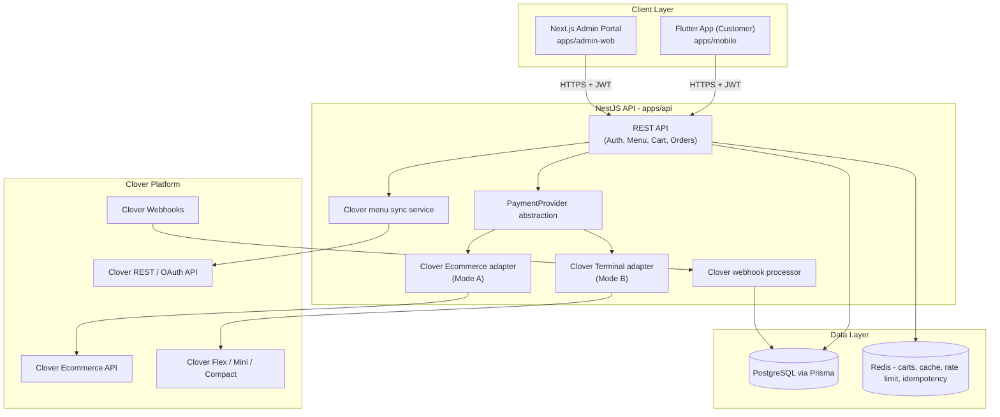

# Restaurant Platform

Production-oriented restaurant ordering platform: a Flutter customer app, a NestJS/
PostgreSQL/Redis backend, and a Next.js restaurant admin portal, integrated with Clover
for menu sync, order creation, payments, refunds, and order-status management.

This repository was built **incrementally, phase by phase** (see [Build phases](#build-phases)
below), and all 7 phases are now complete: monorepo scaffolding, architecture,
configuration, database schema, Docker setup, health endpoints, shared types, developer
docs (Phase 1); authentication, restaurant/menu read endpoints, and Clover OAuth +
inventory sync (Phase 2); the Flutter customer app's browse/menu/item/cart screens plus
guest and customer authentication (Phase 3); authoritative server-side pricing, cart, and
checkout with Clover order creation and sandbox payments (Phase 4); payment confirmation,
webhooks, push notifications, refunds, and idempotent failure recovery (Phase 5); the
Next.js admin portal covering auth, the live order dashboard, menu management, business
settings, and sales reports (Phase 6); and automated backend/mobile tests, legal document
templates, and Google Play release prep (Phase 7).

## Product overview

Customers browse a restaurant's menu (no login required), order pickup or delivery,
pay through Clover, tip, and track their order live. Restaurant admins connect their
Clover account, import/manage the menu, configure business rules (hours, fees, taxes,
delivery radius), run the live order queue, and issue refunds. Employees handle the
order queue without touching payment/ownership settings.

- **Mobile app** (`apps/mobile`): welcome/login/register, browse menu, item detail with
  modifiers, cart, and (through Phase 3 UI) the screens needed to place an order; wired
  to the live checkout/payment/order-status APIs from Phase 4-5 via `packages/api-client`-
  equivalent Dio services in `apps/mobile/lib/features/*`.
- **Admin portal** (`apps/admin-web`): staff login, a live order dashboard (accept/reject/
  status transitions, refunds), menu management (price/availability/featured toggles),
  business settings (hours, fees, delivery radius, Clover connect/disconnect/sync), and a
  sales reports page - see [Admin portal](#admin-portal-phase-6) below.
- **Public pages** (also served from `apps/admin-web`, unauthenticated): the account
  deletion request page and the rendered legal documents - see
  [Legal documentation](#legal-documentation) below.

## Architecture



The mobile app never calls Clover directly and never handles secrets - see
`SECURITY.md` for the full trust boundary.

## Technology stack

**Mobile**: Flutter, Dart, Material 3, Riverpod, GoRouter, Dio, Freezed +
json_serializable, flutter_secure_storage, Firebase (Messaging/Crashlytics/Analytics).

**Backend**: Node.js, TypeScript, NestJS, PostgreSQL, Prisma, Redis, Swagger/OpenAPI,
Docker, Jest.

**Admin portal**: Next.js (React, TypeScript).

**Payments**: Clover Ecommerce API (online/card-not-present) and Clover REST Pay
Display API (in-restaurant terminal), behind a shared `PaymentProvider` interface -
see `CLOVER_SETUP_GUIDE.md`.

## Monorepo layout

```
restaurant-platform/            (this repo root)
  apps/
    mobile/         Flutter customer app
    admin-web/      Next.js restaurant admin & employee portal
    api/            NestJS backend API
  packages/
    shared-types/   Shared TS enums & API contracts
    api-client/     Typed HTTP client used by admin-web
    eslint-config/  Shared ESLint config
  infrastructure/   (reserved for IaC / deployment manifests)
  docs/             (reserved for expanded architecture/runbooks)
  legal/            Legal document templates (privacy, terms, refunds, delivery,
                     account deletion, data retention) - see legal/README.md
  .github/workflows/  CI pipelines
  docker-compose.yml
  README.md, SECURITY.md, GOOGLE_PLAY_RELEASE_GUIDE.md, CLOVER_SETUP_GUIDE.md
```

## Local setup

### Prerequisites

- Node.js 20+
- npm 10+
- Docker Desktop (for Postgres/Redis, and optionally the API container)
- Flutter SDK 3.24+ (only needed to run the mobile app - see `apps/mobile/README.md`)

### 1. Install dependencies

```bash
npm install
```

### 2. Configure environment variables

```bash
cp .env.example .env
cp apps/api/.env.example apps/api/.env
cp apps/admin-web/.env.example apps/admin-web/.env
```

Fill in real values only where you have them (Clover/Firebase). Everything else has a
safe local-dev default. See [Environment variables](#environment-variables) below.

### 3. Start Postgres & Redis

```bash
docker compose up -d postgres redis
```

### 4. Run database migrations & seed data

```bash
npm run prisma:generate
npm run prisma:migrate
npm run prisma:seed
```

### 5. Run the backend

```bash
npm run api:dev
```

The API listens on `http://localhost:3000/api/v1`, with Swagger docs at
`http://localhost:3000/api/v1/docs` and a health check at
`http://localhost:3000/api/v1/health`.

### 6. Run the admin portal

```bash
npm run admin:dev
```

Open `http://localhost:3001`. Log in with a seeded restaurant admin/employee account
(see `apps/api/prisma/seed.ts`), or visit `http://localhost:3001/account-deletion` or
`http://localhost:3001/legal` to see the public, unauthenticated pages.

### 7. Run the mobile app

See `apps/mobile/README.md` for full instructions (generating the Android/iOS platform
folders, Firebase config, and run commands).

## Environment variables

Defined in `apps/api/.env.example` (copy to `.env`, never commit the real file):

| Variable | Purpose |
|---|---|
| `CLOVER_ENVIRONMENT` | `sandbox` or `production` - selects Clover API base URLs |
| `CLOVER_CLIENT_ID` / `CLOVER_CLIENT_SECRET` | Clover OAuth app credentials |
| `CLOVER_MERCHANT_ID` | Connected merchant (set after OAuth) |
| `CLOVER_REDIRECT_URI` | OAuth callback URL |
| `CLOVER_WEBHOOK_SECRET` | Verifies inbound Clover webhook signatures (Phase 5) |
| `CLOVER_ECOMMERCE_PUBLIC_KEY` / `CLOVER_ECOMMERCE_PRIVATE_KEY` | Ecommerce tokenization/charge keys (Phase 4) |
| `CLOVER_API_BASE_URL` / `CLOVER_OAUTH_WEB_BASE_URL` | Optional overrides of the resolved Clover hosts (e.g. non-North-America regions) |
| `CLOVER_USE_MOCK_CLIENT` | Force the in-memory mock Clover adapter; defaults to `true` when no Clover credentials are set |
| `TOKEN_ENCRYPTION_KEY` | Encrypts Clover OAuth tokens at rest (AES-256-GCM) |
| `DATABASE_URL` | PostgreSQL connection string |
| `REDIS_URL` | Redis connection string |
| `JWT_SECRET` / `JWT_REFRESH_SECRET` | Token signing secrets |
| `JWT_ACCESS_TOKEN_TTL` / `JWT_REFRESH_TOKEN_TTL` | Token lifetimes (defaults `15m` / `30d`) |
| `FIREBASE_PROJECT_ID` / `FIREBASE_CLIENT_EMAIL` / `FIREBASE_PRIVATE_KEY` | Firebase Admin SDK (server-side push, etc.) |

Defined in `apps/admin-web/.env.example`:

| Variable | Purpose |
|---|---|
| `NEXT_PUBLIC_API_BASE_URL` | Base URL of the backend API the admin portal calls (e.g. `http://localhost:3000`) |

## Database migrations

```bash
# Create & apply a new migration during development
npm run prisma:migrate --workspace=apps/api -- --name <migration-name>

# Apply existing migrations (CI / production)
npx prisma migrate deploy --schema=apps/api/prisma/schema.prisma

# Inspect data
npm run prisma:studio --workspace=apps/api

# Re-run seed data
npm run prisma:seed
```

## API overview

All routes are versioned under `/api/v1`. Every route requires a JWT access token by
default; routes below marked **public** don't. Full interactive documentation (with
request/response schemas) is at `/api/v1/docs` (Swagger).

### Auth (Phase 2)

| Method & path | Auth | Purpose |
|---|---|---|
| `POST /auth/register` | public | Create a customer account |
| `POST /auth/login` | public | Email/password login |
| `POST /auth/guest-session` | public | Start a guest checkout session |
| `POST /auth/refresh` | public | Rotate a refresh token for a new pair |
| `POST /auth/logout` | public | Revoke a refresh token |
| `POST /auth/forgot-password` / `reset-password` | public | Password reset flow |
| `POST /auth/account-deletion` | public | Anonymize an account by email+password (Phase 5/7, Google Play requirement) |
| `GET /auth/me` | authenticated | Current user identity & roles (no DB round-trip) |

### Restaurants & menu (Phase 2, admin additions in Phase 6)

| Method & path | Auth | Purpose |
|---|---|---|
| `GET /restaurants/:restaurantId` | public | Restaurant details |
| `GET /restaurants/:restaurantId/hours` | public | Posted hours |
| `GET /restaurants/:restaurantId/availability` | public | Open-now / pickup / delivery status |
| `GET /restaurants/:restaurantId/menu` | public | Full menu (categories + items) |
| `GET /restaurants/:restaurantId/categories` | public | Categories only |
| `GET /menu-items/:itemId` | public | Item detail incl. modifier groups/options |
| `GET /restaurants/:restaurantId/menu/search?q=` | public | Menu search |
| `GET /restaurants/:restaurantId/admin/menu-items` | admin/employee, scoped | Full item list for the menu-management UI |
| `PATCH /menu-items/:itemId` | admin, scoped | Update price, availability, sold-out override, featured flag (audit logged) |
| `GET /restaurants/:restaurantId/locations/:locationId/settings` | admin/employee, scoped | Business settings (fees, prep time, delivery radius, etc.) |
| `PATCH /restaurants/:restaurantId/locations/:locationId/settings` | admin, scoped | Update business settings (audit logged) |
| `PUT /restaurants/:restaurantId/locations/:locationId/hours` | admin, scoped | Replace weekly hours (audit logged) |

### Cart & checkout (Phase 4)

| Method & path | Auth | Purpose |
|---|---|---|
| `POST /cart` | public/guest | Create a cart for a restaurant location |
| `GET /cart/:cartId` | public/guest | Get cart with authoritative server-computed pricing |
| `PATCH /cart/:cartId` | public/guest | Update fulfillment type / address / tip |
| `POST /cart/:cartId/items` | public/guest | Add an item (with modifiers) to the cart |
| `PATCH /cart/:cartId/items/:itemId` | public/guest | Update quantity/modifiers for a cart line |
| `DELETE /cart/:cartId/items/:itemId` | public/guest | Remove a cart line |
| `DELETE /cart/:cartId/items` | public/guest | Clear the cart |
| `POST /checkout` | authenticated/guest | Create the order + Clover order, return payment context |

### Payments & orders (Phase 4-5)

| Method & path | Auth | Purpose |
|---|---|---|
| `GET /payments/ecommerce-tokenization-config/:orderId` | authenticated/guest | Public key/config for Clover's hosted card tokenization |
| `POST /payments` | authenticated/guest | Charge a tokenized card (ecommerce) or confirm a terminal payment |
| `GET /payments/:paymentId` | authenticated/guest | Payment status |
| `GET /orders/me` | authenticated | Current user's order history |
| `GET /orders/:orderId` | authenticated/guest | Order detail incl. items, status history |
| `PATCH /orders/:orderId/status` | admin/employee, scoped | Advance order status (accept/reject/prepare/ready/complete/cancel) |
| `GET /restaurants/:restaurantId/orders` | admin/employee, scoped | Live order queue, filterable by status |
| `POST /orders/:orderId/refunds` | admin/employee, scoped | Issue a full or partial refund via Clover |
| `GET /orders/:orderId/refunds` | admin/employee, scoped | Refund history for an order |
| `POST /webhooks/clover` | public* | Clover webhook receiver (order/payment/refund events) |
| `GET /notifications` | authenticated | Current user's in-app notifications |
| `POST /notifications/:id/read` / `read-all` | authenticated | Mark notifications read |
| `POST /notifications/device-tokens` | authenticated | Register a push device token |
| `DELETE /notifications/device-tokens/:token` | authenticated | Unregister a push device token |

### Clover integration (Phase 2, admin status/disconnect added Phase 6)

| Method & path | Auth | Purpose |
|---|---|---|
| `GET /integrations/clover/oauth/start` | admin, scoped | Begin Clover OAuth connect (redirect) |
| `GET /integrations/clover/oauth/start-url` | admin, scoped | Same, returned as JSON for JS clients |
| `GET /integrations/clover/oauth/callback` | public** | Clover OAuth redirect target |
| `GET /integrations/clover/connection-status` | admin/employee, scoped | Connected merchant + last sync time |
| `POST /integrations/clover/disconnect` | admin, scoped | Disconnect Clover (audit logged) |
| `POST /integrations/clover/sync` | admin, scoped | Trigger a full Clover inventory sync |
| `GET /integrations/clover/sync-status` | admin/employee, scoped | Recent sync job history |

### Reports (Phase 6)

| Method & path | Auth | Purpose |
|---|---|---|
| `GET /restaurants/:restaurantId/reports/summary` | admin/employee, scoped | Revenue, order counts, and daily breakdown for a date range, net of refunds |

\* verified via the `CLOVER_WEBHOOK_SECRET` signature, not a user session.
\*\* protected instead by a random, single-use, short-lived `state` token - see
`CLOVER_SETUP_GUIDE.md`.

All admin-scoped routes are protected by `RolesGuard` (role check) and
`RestaurantScopeGuard` (confirms the caller's staff assignment matches the
`:restaurantId`/`:locationId` in the URL). Actions with security or financial impact
(settings changes, menu edits, Clover connect/disconnect, refunds, order status changes)
write an `AuditLog` entry recording the actor, action, and before/after values.

## Admin portal (Phase 6)

`apps/admin-web` is a Next.js app for restaurant staff, built with client-side JWT auth
(access/refresh tokens in `localStorage`, rotated via `AuthProvider` in
`apps/admin-web/src/lib/auth-context.tsx`) and a thin, typed wrapper (`packages/api-client`)
around the backend's admin endpoints. All authenticated pages live behind
`ProtectedLayout` (`apps/admin-web/src/components/ProtectedLayout.tsx`), which redirects
to `/login` if no valid session exists and renders the sidebar navigation.

| Page | Route | What it does |
|---|---|---|
| Login | `/login` | Staff email/password login |
| Orders | `/orders` | Live order queue with status filters, expandable order detail, status-transition actions, and refund initiation |
| Menu | `/menu` | Grouped-by-category item list with inline price editing and availability/sold-out/featured toggles |
| Settings | `/settings` | Business settings (fees, prep time, delivery radius), weekly hours editor, and the Clover connect/disconnect/sync card |
| Reports | `/reports` | Date-range sales summary: revenue, order counts, and a daily breakdown, net of refunds |

Employee accounts see the same order/menu screens but cannot edit business settings or
disconnect Clover (enforced both by the backend's `RolesGuard` and by hiding those
controls client-side for non-admin roles).

## Legal documentation

Templates for all required legal documents live in `legal/` (Privacy Policy, Terms &
Conditions, Refund/Cancellation Policy, Delivery Policy, Account Deletion Policy, Data
Retention Policy) - see `legal/README.md` for their status and what still needs
jurisdiction-specific legal review before publishing. Once finalized, they are served as
public, unauthenticated pages from the admin portal:

- `/legal` - index of all documents
- `/legal/privacy-policy`, `/legal/terms-and-conditions`,
  `/legal/refund-cancellation-policy`, `/legal/delivery-policy`,
  `/legal/account-deletion-policy`, `/legal/data-retention-policy`
- `/account-deletion` - public, unauthenticated account-deletion request form (calls
  `POST /auth/account-deletion`), required by Google Play's Data Safety policy so
  deletion can be requested without installing/opening the app

## Clover developer/OAuth/sandbox setup

See `CLOVER_SETUP_GUIDE.md` for the full walkthrough: creating a Clover app, sandbox
merchant, required env vars, and exactly how the OAuth connect + inventory sync flows
implemented in `apps/api/src/clover` work end to end (including the fully-functional
mock adapter used when no real Clover credentials are configured).

## Testing

```bash
# Backend unit tests
npm run test --workspace=apps/api

# Backend e2e tests (requires postgres/redis running, see docker compose up above)
npm run test:e2e --workspace=apps/api

# Backend lint
npm run lint --workspace=apps/api

# Admin portal lint/build
npm run lint --workspace=apps/admin-web
npm run build --workspace=apps/admin-web

# Flutter tests (from apps/mobile)
cd apps/mobile && flutter test
```

Backend unit tests cover pricing math (`cart-pricing.util.spec.ts`), cart/checkout,
order status transitions, payments, refunds, webhooks, notifications, Clover OAuth/sync,
restaurant/menu admin mutations, and sales reports. Mobile tests cover the cart
controller and app bootstrap/splash behavior. Coverage is intentionally weighted toward
business logic with financial or security impact (pricing, auth, payments, refunds)
over presentational widgets/components.

## Docker

```bash
# Postgres + Redis only (recommended for local development, run the API with npm run api:dev)
docker compose up -d postgres redis

# Full stack including the API container
docker compose up -d --build

docker compose down
```

## Production deployment considerations

- Terminate TLS in front of the API (load balancer/ingress) - the app itself expects to
  run behind HTTPS in production; see `SECURITY.md`.
- Provide `DATABASE_URL` pointing at a managed PostgreSQL instance with automated
  backups, and `REDIS_URL` pointing at a managed Redis instance (idempotency keys and
  guest carts should survive restarts and be shared across API replicas).
- Run `prisma migrate deploy` (not `migrate dev`) as a release step, before the new API
  version starts serving traffic.
- Configure `CORS_ALLOWED_ORIGINS` to the real admin portal / marketing site origins
  only.
- Set `CLOVER_ENVIRONMENT=production` and real Clover production credentials only in the
  production secret store - never commit them.
- Autoscale the API statelessly; all session/cart state lives in Postgres/Redis, not in
  process memory.
- CI/CD gates production releases behind a manual approval step (see
  `.github/workflows/`) - nothing publishes to production automatically.

## Google Play release overview

See `GOOGLE_PLAY_RELEASE_GUIDE.md` for the full walkthrough: application ID, icons,
release signing, building the `.aab`, the Data Safety form (mapped to this app's actual
data practices), the payments/financial-features declaration (Clover, not Google Play
Billing, since orders are for physical goods/services), and internal testing through
production rollout.

Production hosting for the API (Render) and admin portal (Vercel) is covered in
`DEPLOYMENT.md`.

## Build phases

| Phase | Scope |
|---|---|
| 1 (done) | Monorepo, architecture, config, DB schema, Docker, health endpoints, shared types, docs |
| 2 (done) | Auth, restaurant configuration, menu read endpoints, Clover OAuth, Clover inventory sync |
| 3 (done) | Flutter home/menu/item/modifiers/cart, guest & customer auth |
| 4 (done) | Authoritative backend pricing, cart/checkout, Clover order creation, sandbox payments |
| 5 (done) | Payment confirmation, webhooks, push notifications, refunds, idempotency, failure recovery |
| 6 (done) | Admin portal: auth, live order dashboard, menu management, business settings, sales reports |
| 7 (done) | Automated backend/mobile tests, audit logging, legal document templates, Google Play release prep |

All 7 phases are complete. Remaining work before a real-world launch is intentionally
external to code: legal review/sign-off of the `legal/` templates (fill in every
`[BRACKETED]` placeholder), a third-party security/accessibility/performance audit if
required by your organization, and the operational steps in
`GOOGLE_PLAY_RELEASE_GUIDE.md` (real app icons, signing keys, Play Console setup).
